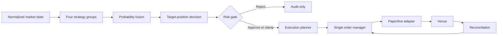

# Architecture

## Implemented runtime and next boundaries

The market profile is now the single selector for asset, contract duration, discovery,
reference feeds and indicator model. One profile runs per process. See
[market profiles](market-profiles.md) for the registry, switching contract and future phases.

The running application is currently a read-only data collector and indicator dashboard.
It does not wire the strategy/risk/execution components into a live order loop. The full
decision flow below is the intended architecture. The implemented snapshot, cache,
reference analysis and optional TradingAgents research boundary are documented in
[the integration guide](tradingagents-integration.md).

## Principle

The system is a modular monolith for the first milestone. Workers currently exchange persisted
market state through PostgreSQL inside one `trader` service; a typed event bus is not implemented.
PostgreSQL is the durable system of record. This avoids distributed
ordering and duplicate-message problems before the order lifecycle is proven.

## Decision flow

## Ownership boundaries

### Strategies

Strategies consume immutable market snapshots and emit probability estimates with confidence,
timestamps, expiry and evidence. They cannot import an execution adapter.

### Fusion

Fusion rejects expired or invalid signals and combines calibrated estimates. Initial weights are
configuration, not learned online. Online self-modification is prohibited in the live process.

### Decision engine

The decision engine compares fair probability with executable price, explicit costs and a risk
buffer. It emits a target position, not an order.

### Risk engine

The risk engine is fail-closed. It may reject or reduce a target based on stale data, exposure,
loss limits, reconciliation state or operational health. It cannot create or reverse a target.

### Execution planner

The planner chooses maker, taker or skip; price; quantity; time-in-force; expiry and repricing
limits. It is the only component that converts an approved target delta into an order intent.

### Order manager

The manager assigns an idempotency key, persists intent before submission, submits through one
adapter, tracks partial fills and reconciles after reconnect or restart. Unknown remote state puts
the system in safe mode.

## Data ownership

- PostgreSQL: signals, decisions, risk outcomes, order intents, orders, fills, positions, balances,
  settlements and audit records.
- Parquet: append-only raw and normalized market events, including venue event time and local
  receive time.
- Prometheus: operational time-series metrics, never authoritative trading state.

## Failure posture

No new order may be submitted when the durable intent cannot be written, market data is stale,
account state is unreconciled, or the execution adapter reports ambiguous state. Retrying an
ambiguous submit is forbidden until remote state has been queried.
