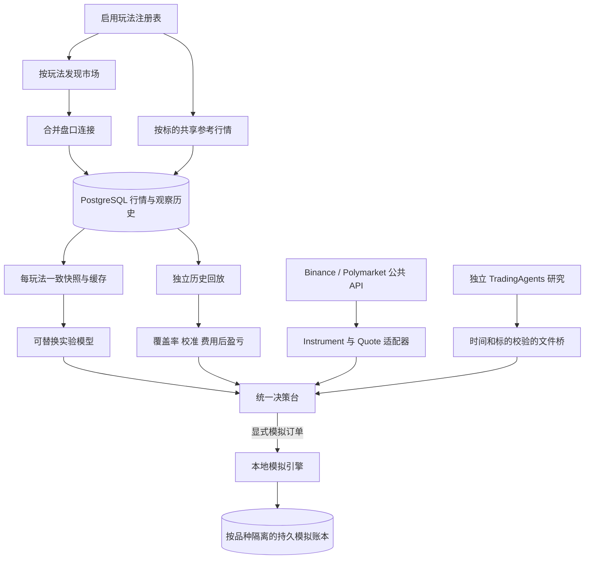

# 多玩法实施记录

本轮部署、测试及重启验收已完成，具体证据见 [2026-09-19 部署验收](deployment-20260919.md)。

目标：保留原 BTC5 的数据和分析能力，逐步把玩法、参考源、模型、执行与外部研究分开，
使其他周期、标的和交易类型复用同一基础设施。

| 步骤 | 已实现内容 | 验收方式 |
|---|---|---|
| 1 | BTC5/BTC15/ETH5 注册表；TWAP 修正；配置、模型与缓存按玩法派生 | 单元、混合 PostgreSQL、真实 Gamma/CLOB/Chainlink/Binance |
| 2 | 三玩法并行；共享采集；页面切换；独立回放和定时报告 | 线程监督、缓存隔离、真实浏览器、历史可得性及费用/结算测试 |
| 3 | Binance BTC/ETH 现货、USDT 永续；普通 Polymarket YES/NO 事件；持久模拟账本 | 真实公共报价与交易规则、成交/持仓/资金费/结算/重启及重复请求测试 |

本轮部署使用四个原有容器及数据卷；无新增数据库或消息中间件。
独立 Windows 中继解决本机 WSL 网络问题，未修改隔壁 TradingAgents。
运行命令见 [玩法与操作](market-profiles.md)，交易类型细节见 [模拟交易](paper-trading.md)。

## 结构

## 数据和执行边界

- PostgreSQL 保留原行情，追加费率元数据观察历史、结算接收时间和独立报告表。
  迁移幂等；旧结算行的首次可得时间记为迁移时刻，不冒充历史已知。
- SQLite 账本存在原 market_data 卷；首次明确模拟订单才创建该品种的虚拟账户。
  同订单编号同参数返回原成交，参数冲突拒绝；重启不会重置账户。
- 现货不支持裸卖空；永续使用独立保证金语义和保守杠杆限制；普通事件以真实 token
  映射和明确最终结算结果兑换。跨玩法不会共用含糊的仓位键。
- 行情、概率和研究各自检查时效。研究不阻塞采集，不触发订单，不捏造短周期概率。
- 永续资金费仅在显式记账后计入；维护保证金触发停止，未实现交易所强平引擎。
- 真实账户、钱包和真实下单不在本次运行范围。自动策略循环尚未接入。
- 新数据与历史回放验证支持工程正确性，不构成策略盈利或模型校准证据。

## 后续研究

可在已固定的样本外窗口比较简单基准与本地模型，再评估 TradingAgents 背景信息的增益。
当前模型开盘价仍为严格时间容差内的本地参考近似；官方开盘/收盘基准核验、真实排队与
部分成交、跨窗口资本分配和策略自动执行，需要各自明确数据和验证后再推进。
