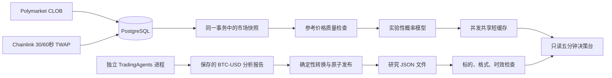

# BTC 五分钟项目优化与 TradingAgents 集成

多玩法改造已支持 BTC5、BTC15、ETH5 并行与独立回放，切换步骤见
[玩法选择与扩展](market-profiles.md)。本文保留第一轮改造背景，研究文件契约现支持
BTC-USD / ETH-USD，导出用 `--symbol` 选择，消费时严格匹配当前标的。

本轮改动位于 `~/projects/prediction-trader`。参考了
[TauricResearch/TradingAgents](https://github.com/TauricResearch/TradingAgents) 的源码；
没有修改隔壁正在部署的 TradingAgents。核对日期：2026-09-19。

## 当前运行边界

当前部署与验收记录见 [多玩法实施记录](multi-market-plan.md)。
本文后续保留首轮重构的技术依据；当前程序还包括多玩法定时回放，以及显式模拟交易接口。
本机 `./pt start` 已启用只读研究挂载。实际 TradingAgents 的 `result.json` 有生成时间、
评级和到期时间，但没有市场/新闻证据的 `data_as_of`；界面将显示
`missing_evidence_timestamp`，不把运行开始时间或模拟账本时间冒充证据时间。

`app.py` 启动发现、行情采集、K 线聚合、结算同步、独立回放和统一决策台。
现有 strategy → fusion → decision → risk → execution 是可独立测试/回放的模块，
尚未接成主程序的自动下单循环。文档中的四组策略和完整交易链是目标架构，
不能据此判断已经实现实时交易。

TradingAgents 的分析日期、Buy/Hold 等评级和以交易日为单位的持仓周期，
不是五分钟二元合约的胜率。其分析师、辩论和风险审核包含多次模型调用，
不适合阻塞当前行情处理。因此本次以独立研究文件接入，无新增 LLM 依赖。

## 结构



模块职责：

| 模块 | 职责 |
|---|---|
| `services/chainlink_reference.py` | 真实 TWAP 订阅、精确价格解析、断流重连 |
| `reference_analysis.py` | 不依赖数据库的不可变观测与质量检查 |
| `indicator_state.py` | 一致的数据库读取、合约窗口匹配、API 快照 |
| `services/snapshot_cache.py` | 合并并发读取、TTL、五分钟切换失效 |
| `research/context.py` | 有类型的研究文件契约、有效期、原子发布 |
| `research/export_cli.py` | 转换上游已保存的报告，不调用 LLM |
| `services/indicator_server.py` | HTTP 展示、缓存接入和错误处理 |

## 已落实的优化

1. **减少重复读取**：完整双向报价快照由 10 次 SQL 查询减为 7 次。
   两个方向的盘口、更新速度、交易流分别批量查询；
   所有读取在同一 `REPEATABLE READ` 事务中完成。
   这是查询次数减少 30%，不是已实测延迟降低 30%。
2. **共享短缓存**：默认 0.5 秒 TTL；并发浏览器请求只触发一次在途加载。
   缓存在五分钟边界失效，跨边界完成的加载会重新读取；
   数据库失败时不返回旧快照。HTTP 响应为 `no-store`。
3. **准确选择窗口**：按五分钟 slug 和到期时间精确匹配当前、下一窗口，
   不再用同名十五分钟合约或未开盘的下一窗口代替当前市场。
4. **更正数据源**：原来的 `crypto_prices_chainlink` 是普通价格频道，
   不能直接标记成 TWAP。现改为 `crypto_prices_twap_sixty`
   （可配置 thirty），并校验 `window_s`、BTC 标的和
   `full_accuracy_value` 的 E18 精度。依据
   [Polymarket 官方 TWAP 文档](https://docs.polymarket.com/market-data/chainlink-twap)。
5. **防止误导的概率**：开盘后默认两秒内没有观测，不取中途价格伪造开盘价；
   参考价超过五秒、最近一分钟样本不足或出现超过十秒断档时暂停概率。
   过滤事件时间/接收时间晚于快照的记录，去重同时间戳。
   开盘近似值仍明确标注未核验，不等价于官方结算开盘值。
6. **页面一致性**：断线/等待市场时清空旧概率和旧报价；浏览器轮询不重叠。
   刷新不再覆盖手工输入的买入价和费率，需点击按钮填入。
   盘口和报价分别检查数据龄；超过五秒或盘口未核验时标记陈旧并禁止填入。
   参考价格模型与盘口状态分别判断。
7. **独立研究接入**：研究结果只作背景展示，无概率映射、策略融合或下单调用。

新 TWAP 数据分别存为 `polymarket_rtds_chainlink_twap_60` /
`polymarket_rtds_chainlink_twap_30`。历史 spot 行保留，但不会混入新模型。
切换后需要重新积累历史；若中途启动且缺少开盘观测，会等下一窗口。

## 对接隔壁 TradingAgents

推荐独立进程/容器，现有四容器无需再加一套数据库或消息中间件。
TradingAgents 的全局数据源配置、按日期命名的日志和检查点不适合与
五分钟行情线程共进程复用，也不适合直接当每个交易窗口的账本。

### 1. 导出已完成的研究结果

当前上游 `TradingAgentsGraph._log_state` 保存 flat `full_states` JSON，
含 `company_of_interest`、`trade_date` 和 `final_trade_decision`。
桥接器严格解析上游规范的五段 PortfolioDecision Markdown。
格式不符或评级为 REVIEW 会拒绝，不猜测自然语言方向。

在 WSL 原项目中运行：

```bash
cd ~/projects/prediction-trader
mkdir -p data/research

# 以下三个变量应来自生产该报告的任务记录：
# TA_REPORT：已保存的 BTC-USD full_states JSON 完整路径
# TA_DATA_AS_OF：该报告证据实际覆盖到的 UTC 时间，含时区
# TA_COMPLETED_AT：原分析完成时间，含时区；不得改为重新导出时间
.venv/bin/python -m prediction_trader.research.export_cli "$TA_REPORT" \
  --output data/research/btc-usd.json \
  --data-as-of "$TA_DATA_AS_OF" \
  --generated-at "$TA_COMPLETED_AT" \
  --source-timezone Asia/Singapore \
  --ttl-seconds 900
```

新增安装入口为 `prediction-research-export`；已有开发虚拟环境无需重装，
可直接使用上面的 `python -m`。上游源码当前不保存精确完成时间，
生产任务应另行记录并传入。不能从文件修改时间推断数据时间。
该桥面向当天的新鲜研究，旧日报/历史回测报告会被拒绝。
日期核验使用明确指定的生产者时区，不猜测宿主机时区；若隔壁容器按 UTC
生成报告，把示例改成 `--source-timezone UTC`（默认值）。时间戳仍统一存为 UTC。
`data_as_of` 是生产者声明，桥接器不能证明报告实际使用了哪些时点的数据。

桥接器强制：

- `symbol = BTC-USD`；评级只能是 Buy / Overweight / Hold / Underweight / Sell；
- `data_as_of <= generated_at <= available_at < valid_until`；
- 证据和有效期最多一小时；默认 TTL 为原生成时间后的 15 分钟；
- 重新导出不刷新有效期；报告日期必须匹配原生成时间在生产者时区下的日期；
- 单个消费文件最多 64 KiB；原子替换，不暴露半写入内容；
- 文件为非秘密的研究摘要，以 0644 发布，供容器用户只读；
  挂载目录也需可遍历。不要在报告里放密钥或私人账户信息。

未启用、文件不存在、损坏、过期或来自未来的报告，都有独立状态；
不会阻止行情与本地概率计算。文件只用于实时展示，不进入历史回放。
`source_run_id` 默认是输入文件 SHA-256，可另存源报告以便追溯。

### 2. 配置只读消费目录

已准备可选 Compose 覆盖文件：

```bash
docker compose -f deploy/compose.yaml -f deploy/compose.research.yaml config --quiet
```

它把本项目 `data/research/` 挂载到 trader 的 `/research:ro`，
并设置 `RESEARCH_CONTEXT_PATH=/research/{symbol}.json`，随玩法选择 btc-usd / eth-usd。
挂载的是整个目录，以便原子替换后容器看到新文件。
如果另选目录，设置 `RESEARCH_CONTEXT_DIR` 为宿主机绝对路径。

需要部署修改时：

```bash
docker compose -f deploy/compose.yaml -f deploy/compose.research.yaml up -d --build trader
```

不使用研究接口时，继续用原 Compose 即可；默认路径为空，功能关闭。
本机部署通过 `pt` 合并 local 与 research 覆盖文件；没有替隔壁生成研究或调用模型。

### 3. 可选数据库索引

为已有大表准备了独立的并发建索引脚本，本轮已在运行库应用五个索引。
部署时可在数据库可用后执行：

```bash
docker compose -f deploy/compose.yaml exec -T postgres \
  psql -U prediction -d prediction -v ON_ERROR_STOP=1 \
  < deploy/postgres/indicator_indexes.sql
```

脚本对窗口、标的和时间组合建立索引；不得包在事务内。
实际收益应通过真实数据上的 EXPLAIN ANALYZE 和接口延迟测量确认。

## 配置与验证

新增配置均已列在 `.env.example`：

```dotenv
POLYMARKET_CHAINLINK_TWAP_WINDOW_SECONDS=60
INDICATOR_CACHE_TTL_SECONDS=0.5
INDICATOR_MAX_REFERENCE_AGE_SECONDS=5
INDICATOR_MAX_QUOTE_AGE_SECONDS=5
INDICATOR_OPENING_TOLERANCE_SECONDS=2
RESEARCH_CONTEXT_PATH=
```

运行检查：

```bash
.venv/bin/pytest -q
.venv/bin/ruff check .
.venv/bin/mypy
```

`tests/test_indicator_state_db.py` 默认跳过；设置
`PREDICTION_TEST_DATABASE_URL` 指向独立 PostgreSQL 测试库可运行真实 SQL 测试。
每个测试创建并删除自己的 UUID schema，不要指向生产库。

本轮已在临时 PostgreSQL 17 验证真实查询、七次 SELECT、同一事务、
TWAP 数据隔离、时间过滤、两方向盘口和退化行为；临时容器已清理。
最终验证为 117 项普通测试通过，另有 13 项真实 PostgreSQL 测试通过；
默认运行会跳过这 13 项，需单独提供测试数据库。Ruff、mypy 与 Compose
配置校验通过，五个并发索引也已在临时库验证创建及重复执行。
还覆盖并发缓存、失败恢复、HTTP 错误响应、报告过期和错误格式等测试。
以上为首轮历史验证记录。当前本机专用 HTTPS 中继已解决连接问题，真实 TWAP、
Gamma、CLOB 和 Binance 验证已通过；最终整体验收见多玩法实施记录。

## 后续优先级

1. 保存官方开盘/收盘 TWAP 基准并核验合约规则，解决开盘近似值限制。
2. 对五分钟窗口做事件级回放：费用、延迟、滑点、部分成交和结算一致性。
3. 固定验证集评估 Brier score、校准曲线、有效样本覆盖率和净收益；
   先比较本地指标基线，再比较加入研究信息后的增益。
4. 若研究确有增益，再新增经过校准的 Strategy 实现，并通过既有风险门控；
   不能人工把 Buy 固定换算为 0.6/0.7 的上涨概率。
5. 生产者需要稳定的 run_id、秒级数据截止时间、模型/配置版本、
   成本和耗时记录；在证明必要前维持模块化单体与文件接口。

本次验证的是数据正确性、模块边界与读取效率，没有得到胜率或收益提高的证据。
